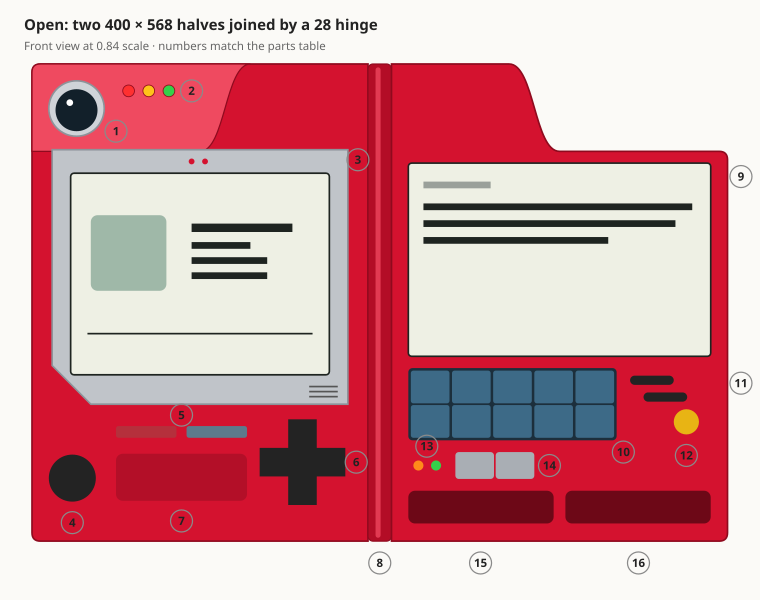
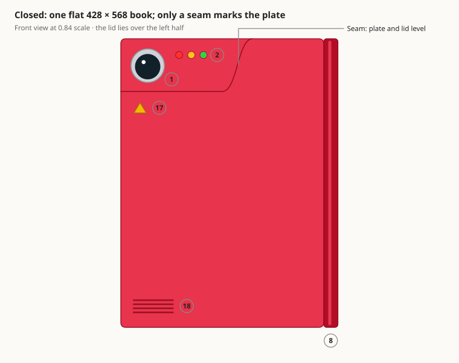
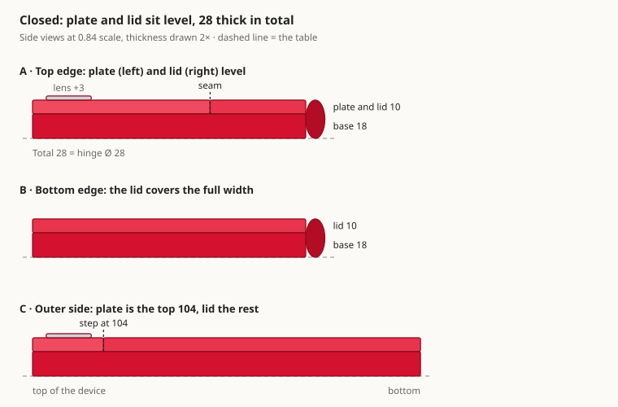
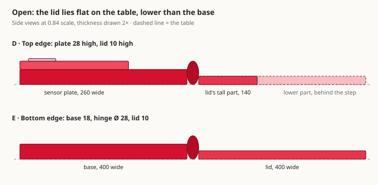

# pokeggdex Design Document

Oct 9, 2026

## Overview

The pokeggdex is two 400 × 568 halves joined by a round 28 hinge. The right half (the lid) folds over the left half into a closed book of 428 × 568 × 28.

- **Based on:** the pokeggdex from the first season of the Pokémon anime, with Game Boy-style screens from Pokémon Red/Blue.
- **Built as:** a React web app (Vite) that reads live data from PokéAPI. It sits on a pixel-art game-world background.
- **Units:** all sizes are CSS pixels at desktop size. The drawings are at 0.84 × that scale.
- **Key idea:** a raised sensor plate holds the lens and lights. When closed, the lid fits around it and both form one flat surface.

## Front view, open

Open, the left half holds the lens, lights and main screen; the lid holds the right screen, keypad and search.

The lighter area at the top-left is the raised sensor plate. The lid is tall next to the hinge and steps down 104 at its outer end.

## Front view, closed

Closed, the pokeggdex is a flat 428 × 568 rectangle with the hinge on its right edge. The lens and lights stay visible on the sensor plate.

The lid's low part lands exactly around the plate, so the two read as one surface. The yellow triangle and grip lines sit on the lid's outside.

## Side views, closed

Closed, the device is 28 thick: an 18 base with a 10 layer on top, made of the sensor plate and the lid side by side.

Only a seam separates plate and lid; the lens rises 3 above them. The hinge's diameter equals the total thickness, giving a round spine.

## Side views, open

Open, the lid turns 180° around the hinge's centre and lies on the table: its top is 10 high, against 18 for the base and 28 for the plate.

At the top edge only the lid's tall part next to the hinge reaches the front; the rest of the lid sits further back, behind its step.

## Dimensions

Closed, the pokeggdex measures 428 × 568 × 28; open, it is 828 × 568. Width runs across the front, height top to bottom, thickness off the table.

| Part | Width | Height | Thickness | Notes |
| --- | --- | --- | --- | --- |
| Left half (base) | 400 | 568 | 18 | Outer corners rounded 10 |
| Sensor plate | 260 at the top edge, 200 at its lower edge | 104 | +10 on the base | S-curved edge, 60 wide, between 200 and 260 from the left |
| Lid (right half) | 400 | 568 | 10 | Tall part 140 next to the hinge; S-curved step 60 wide, 104 deep |
| Hinge | 28 | 568 | Ø 28 | Lid turns around its centre line |
| Closed device | 428 | 568 | 28 | Plate and lid flush on top |
| Open device | 828 | 568 | 28 at the plate, 18 base, 10 lid | Open lid lies on the table, lower than the base |
| Main screen bezel | 352 | 303 | flush | Bottom-left corner cut at 46 |
| Right screen | 360 | 230 | flush | Starts 118 below the lid's top |
| Keypad | 248 | 86 | keys raised | 2 × 5 keys, 2 apart |

## Parts and functions

Every part on the device does something in the app; the numbers match the front-view drawings.

| No. | Part | Where | What it does |
| --- | --- | --- | --- |
| 1 | Lens | Sensor plate | Glows blue while the app waits for the API |
| 2 | Status lights (red, yellow, green) | Sensor plate | Red = error, yellow blinking = loading, green = ready |
| 3 | Main screen | Left half | pokeggdex page: sprite, name, category, height, weight, number |
| 4 | Round black button | Left half | Plays the Pokémon's original 8-bit cry |
| 5 | Red and grey-blue buttons | Left half | Normal or shiny colours |
| 6 | D-pad | Left half | Left/right: previous or next Pokémon. Up/down: change the right screen's mode |
| 7 | Recessed panel | Left half | Engraved "pokeggdex" |
| 8 | Hinge | Between the halves | Click to fold the lid shut or open it |
| 9 | Right screen | Lid | Modes: Entry, Stats, Moves, Sprites, List |
| 10 | Keypad (2 × 5) | Lid | Type a pokeggdex number; jumps there after 3 digits |
| 11 | Black slits | Lid | Upper: clear the number. Lower: random Pokémon |
| 12 | Yellow button | Lid | OK: go to the typed number |
| 13 | Small lights | Lid | Orange = typing a number, green = cry playing |
| 14 | Grey arrow buttons | Lid | Change the right screen's mode |
| 15 | Number panel | Lid | Shows the typed number and keypad messages |
| 16 | Search panel | Lid | Search by name or number; matches show in List mode |
| 17 | Yellow triangle | Lid outside | Decoration, visible when closed |
| 18 | Grip lines | Lid outside | Decoration, visible when closed |

The keyboard mirrors the device: arrow keys = D-pad, digits = keypad, Enter = OK, Esc = clear.

## Colours, materials and the fold

The body is glossy red plastic. Screens are flat, and physical buttons stand out from the surface.

| Element | Colour | Finish |
| --- | --- | --- |
| Body | #D4122F, lighter #E8344C towards the top-left | Glossy plastic, soft diagonal gradient |
| Sensor plate and lid outside | #EF4A60 to #D4122F | Same surface, so the closed device reads as one piece |
| Plastic thickness | #8F0A1E base, #B0102A lid | Edges show half the thickness, seen slightly from above: base 9, lid 5, plate 5, hinge 14, closed 14 |
| Screens | #EEF0E4 background, #1E2420 text | Flat, Game Boy look, pixel fonts |
| Keys | #3D6A87 slate blue, #1C2F3C frame | Tight grid, shallow bevel |
| Buttons | Black #232323, yellow #E8B414, grey #8F959C | Raised 4, sink 3 when pressed |
| Lens | Silver ring #CFD3D8, sky-blue glass #A9D6EF to #23649A | Clear daytime sky: white shine, two small clouds; glows #7FC9F0 while loading |

**How the fold works:**

1. The lid turns 180° around the hinge's centre line, over 0.9 seconds.
2. The lid has two faces: the inside with all controls, and the outside with the triangle and grip lines. Each face hides when turned away.
3. Closed, the lid's low part lands exactly around the sensor plate, so both meet flush.
4. The closed book slides 200 to the right so it stays centred.

On phone-width screens the halves stack vertically and do not fold.

## Open questions

Four decisions about the form are still open; the drawings show the current proposal.

- [ ] Thickness: keep base 18 and lid 10, or make them equal?
- [ ] Open lid: lower than the base (as drawn), or level with it like the 3D reference render?
- [ ] Lens: stick up 3 above the plate (as drawn), or sit completely flush?
- [ ] Edges: keep 10 rounding on the outer corners only, or round the edges as well?
