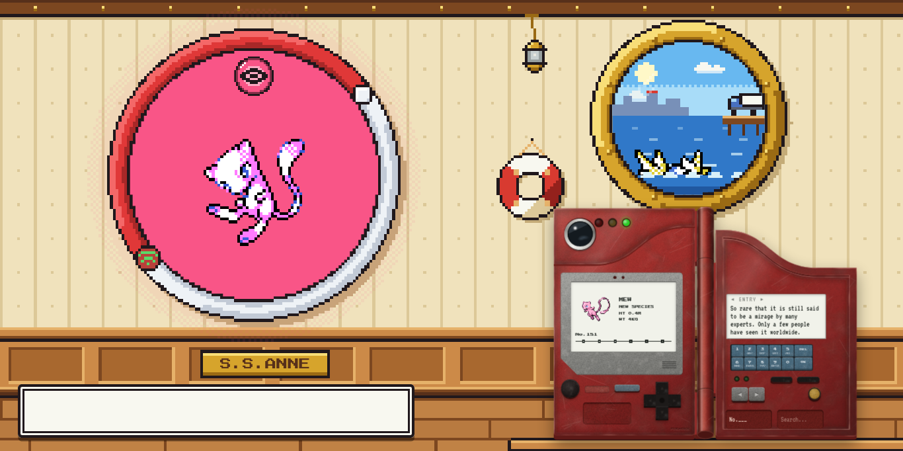
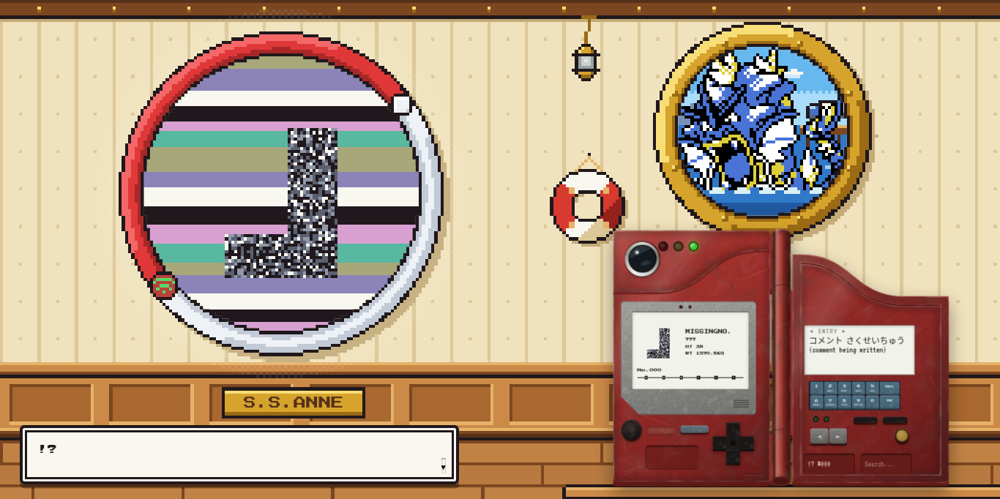
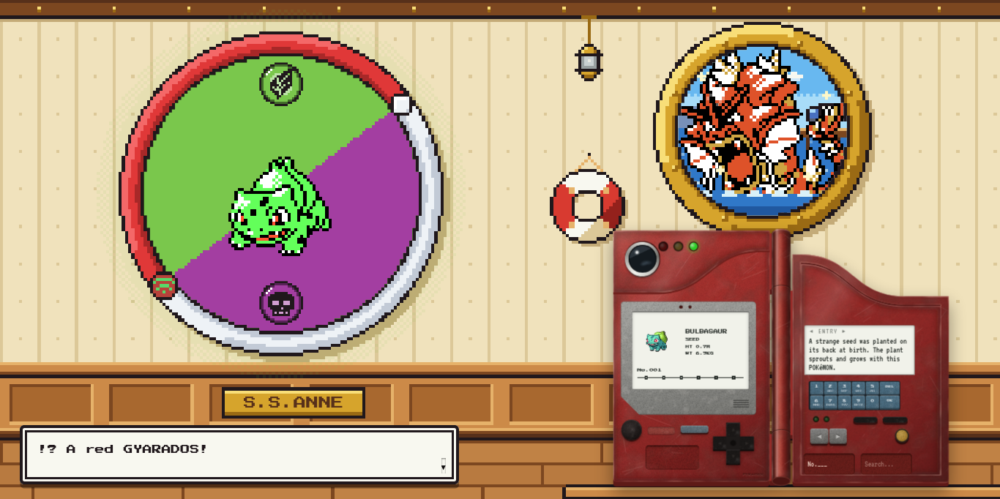
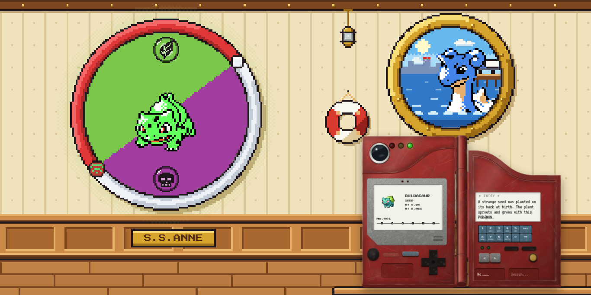
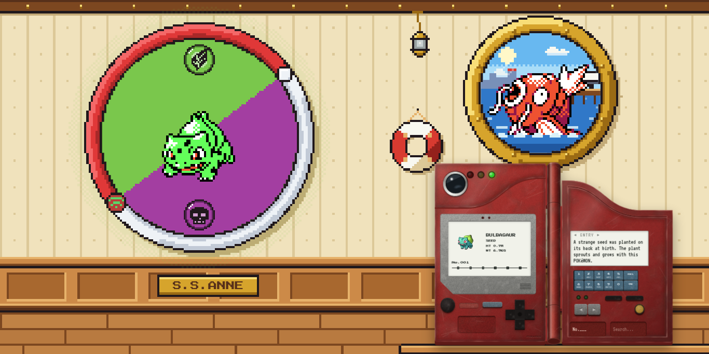
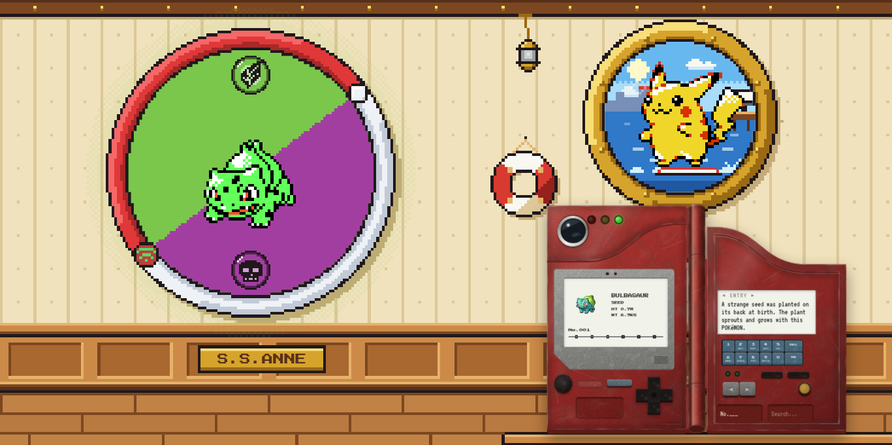
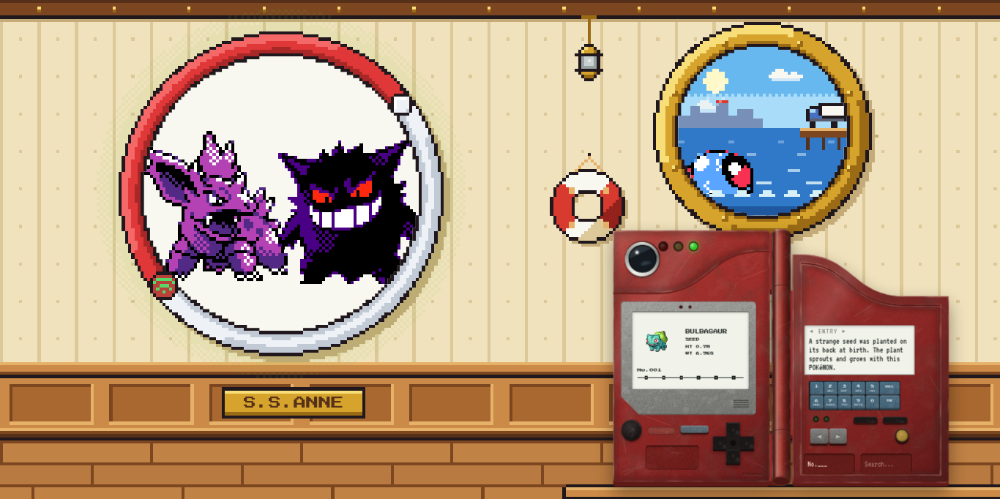
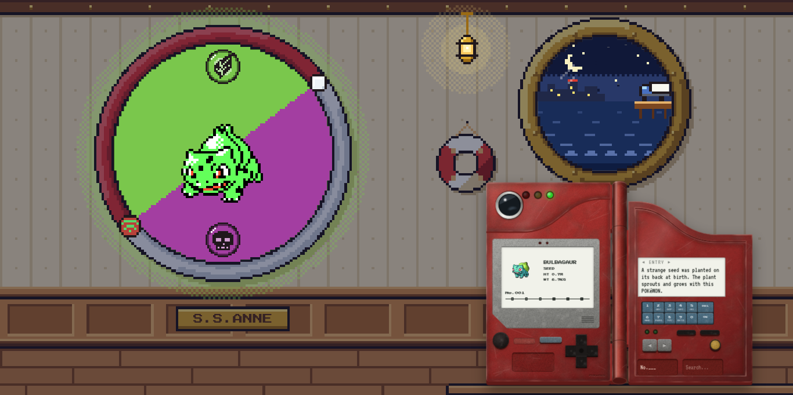

# Pokéggs: the easter eggs aboard the S.S. Anne

**Spoilers ahead.** This lists every hidden thing in the cabin around the Pokédex, how to find it, and the piece of Pokémon history behind it.

Each egg was tested in the running app on 10 Oct 2026. Screenshots are in [`screenshots/`](screenshots/).

**First, switch on the wall screen:** it starts off. Press the small red button at the lower-left of the round screen and it links to the Pokédex after a moment. Eggs 2 and 7 show up on that screen.

## Quick list

| # | Egg | How to find it |
| --- | --- | --- |
| 1 | Mew under the truck | Click the truck on the dock 3 times |
| 2 | MissingNo. | Keypad `000`, or search `missingno` |
| 3 | Shiny visitors | Watch the porthole: 1 in 8192 |
| 4 | Friday Lapras | Look out the porthole on a Friday |
| 5 | Magikarp salesman | Click a jumping Magikarp |
| 6 | Surfing Pikachu | A rare porthole visitor, click it |
| 7 | Red/Blue intro | Don't touch anything for 45 seconds |
| 8 | Cabin signs | Click the life ring, the plaque, the porthole glass |
| 9 | Gen 2 clock | Visit in the morning, day and night |
| 10 | Console hint | Open developer tools (F12) |

---

## 1. Mew under the truck

**How to find it:** click the white truck on the dock, seen through the porthole. Click it three times.

**What happens:**

1. "There's a TRUCK parked on the dock. / People say MEW is hiding under it..."
2. "RED used STRENGTH! / ...The TRUCK won't budge."
3. "...!? / Something pink darted out from under the TRUCK!" and the Pokédex jumps to **No.151, Mew**.

**The lore:** in Pokémon Red and Blue, a lone truck sits on the dock next to the S.S. Anne. You can only reach it in a narrow window of the game. That was enough for a schoolyard rumour: push the truck with Strength and Mew is underneath. It was never true, but every kid in 1999 knew someone whose cousin had done it.

**Tested:** all three messages appear in order, and the Pokédex ends on Mew, No.151. 

---

## 2. MissingNo. at No.000

**How to find it:** type `0 0 0` on the Pokédex keypad (or `0` and OK), or press the 0 key three times on your keyboard. You can also type `missingno` in the search box and press Enter.

**What happens:**

- The wall screen breaks into flickering glitch bars with MissingNo.'s famous "backwards L" sprite.
- The Pokédex reads **MISSINGNO.**, category **???**, HT 3m, WT 1590.8kg, and the keypad panel shows `!? #000`.
- The entry screen says **コメント さくせいちゅう** ("comment being written").
- A text box: "!? / The 6th item in your BAG multiplied! / ...Better not save the game now."
- Its stats and moves are the real ones (see below). Press ◀ or ▶ to get back to the normal Pokédex.

**The lore:** MissingNo. ("Missing Number") is the most famous glitch in Pokémon. In Red and Blue you talked to the old man in Viridian City, flew to Cinnabar Island and surfed up and down its east coast. Everything here is as the games show it:

- **Types:** BIRD / NORMAL. Bird was a type cut from the games before release.
- **Size:** 10'00" and 3507.2 lb (3.0 m, 1590.8 kg).
- **Base stats:** HP 33, Attack 136, Defense 0, Speed 29, Special 6.
- **Moves:** Water Gun, Water Gun, Sky Attack.
- **Pokédex text:** nobody ever wrote one. The Japanese games literally say "comment being written".
- **The item glitch:** meeting it adds 128 to the 6th item in your bag, the classic Rare Candy trick.
- **The warning:** players were warned that saving afterwards could scramble the Hall of Fame.

**Tested:** keypad `000` and the search box both reach it. Name, category, size, types, all six stats, the three moves and the bag message all match the list above. ▶ from No.000 returns to No.001. 

---

## 3. Shiny visitors, at the real 1-in-8192 odds

**How to find it:** watch the porthole. Every 10–20 seconds or so a Pokémon swims past, and each one has a 1 in 8192 chance of being shiny. Leave the page open long enough and you might see one. Most people never will.

**What happens:** the shiny Pokémon appears in its alternate colours, sparkles, and a text box pops up by itself:

- **Red Gyarados:** "!? A red GYARADOS! / Shouldn't it be at the LAKE OF RAGE? / (The odds of seeing one: 1 in 8192.)"
- **Any other:** "!? This MAGIKARP's colours are... different! / (The odds of seeing one: 1 in 8192.)"

**The lore:** shiny Pokémon arrived in Gold and Silver, at odds of exactly 1 in 8192. The games also had one guaranteed shiny, the red Gyarados of the Lake of Rage, which is why a red Gyarados anywhere else is a surprise.

**Tested:** with the dice rigged to roll shiny, the first visitor (a Magikarp) appeared shiny within a second and the message showed. A forced red Gyarados showed all three lines. Unrigged, the code uses `Math.random() < 1 / 8192`. While testing, I also found and fixed a bug: in development the first visitor came 9–23 seconds late instead of after 3.5. 

---

## 4. Lapras only comes on Fridays

**How to find it:** look out the porthole on a **Friday**, by your computer's own clock. On Fridays, Lapras is one of the Pokémon that can swim past, half under the water. On any other day it never appears. Click it as it passes.

**What happens:** "A LAPRAS! It ferries people across the sea. / They say one surfaces in UNION CAVE... but only on FRIDAYS."

**The lore:** Gold, Silver and Crystal had a real-time clock. Deep in Union Cave, a wild Lapras appears only on Fridays, and players planned their week around it.

**Tested:** with the dice rigged to pick the last visitor in the list, an ordinary day gave a Pikachu (Lapras is left out), while a simulated Friday gave Lapras. Clicking it showed both lines. 

---

## 5. The Magikarp salesman

**How to find it:** wait for a Magikarp to leap across the porthole (it's the most common visitor) and click it mid-jump.

**What happens:** "MAN: Hello, there! Have I got a deal just for you! / I'll let you have a swell MAGIKARP for just ¥500! / MAGIKARP used SPLASH! ...But nothing happened!"

**The lore:** in the Pokémon Center at Mt. Moon, a man sells you a Magikarp for ¥500. It feels like a scam: Magikarp's only move, Splash, famously does nothing. But it evolves into Gyarados, so it's actually a good deal.

**Tested:** clicking a jumping Magikarp showed all three lines. 

---

## 6. Surfing Pikachu

**How to find it:** a rare porthole visitor (about 1 in 30 visits): Pikachu riding a surfboard across the waves. Click it.

**What happens:** "!? A PIKACHU is SURFING! / It must be on its way to PIKACHU's BEACH."

**The lore:** in Pokémon Yellow, a Pikachu that knows Surf (from a special event) unlocks a surfing minigame called Pikachu's Beach, in a house on Route 19.

**Tested:** clicking the surfing Pikachu showed both lines. 

**The other visitors** aren't eggs, but they talk too. Tentacool says the sea is full of them and to stock up on Repels (anyone who surfed in Red and Blue remembers the Tentacool). An ordinary Gyarados points out it was a Magikarp once.

---

## 7. The Red and Blue intro on the wall screen

**How to find it:** leave the page alone for **45 seconds**: no mouse, no keys.

**What happens:** the wall screen goes white and plays the opening of Pokémon Red and Blue. Nidorino hops on the left, facing Gengar on the right. Move the mouse or press any key and it goes back to your Pokémon.

**The lore:** the title sequence of Red and Blue is a Gengar vs Nidorino battle. Fans have argued for years that it was a nod to the two lead developers' favourite Pokémon, or a hint at the rivalry.

**Tested:** after 30 s idle the screen still showed Bulbasaur. After 46 s it showed Nidorino (No.033) and Gengar (No.094). One mouse move brought Bulbasaur straight back. 

---

## 8. Things you can read in the cabin

Like walking up to a sign in the games, clicking parts of the cabin brings up a text box.

| Click | You get | The lore |
| --- | --- | --- |
| **The life ring** (between the screen and the porthole) | "OAK: RED! / This isn't the time to use that!" | Professor Oak's scolding when you try to use an item in the wrong place, like the bike indoors. |
| **The brass S.S.ANNE plaque** (on the wood panelling) | "SAILOR: The S.S.ANNE is a famous luxury cruise ship. / We visit VERMILION once a year." | What the sailors tell you about the ship in Red and Blue. |
| **The porthole glass** (anywhere outside the truck and visitors) | "VERMILION CITY / The Port of Exquisite Sunsets" | Vermilion's town sign, word for word. |

**Tested:** all three show the right text. The life ring first failed when clicked in its middle (the click went through the hole), so I fixed it; now the middle and the band both work.

---

## 9. The cabin runs on the Gold/Silver/Crystal clock

**How to find it:** visit at different times of day, by your computer's clock.

**What happens:**

| Time | Name in the games | The cabin |
| --- | --- | --- |
| 4:00–9:59 | MORN | Pink sunrise behind Vermilion's skyline, lamp on |
| 10:00–17:59 | DAY | Blue sky, sun and clouds, lamp off |
| 18:00–3:59 | NITE | Moon and twinkling stars, lit windows in town, the lamp glowing, the room dark, and the screen's light spilling onto the wall in the Pokémon's type colour |

**The lore:** Gold and Silver were the first Pokémon games with a real-time clock, and they split the day into exactly these three parts. Some Pokémon only appear at night, and berries regrow daily. (The Friday Lapras in egg 4 runs on the same clock.)

**Tested:** the boundary times give the right part of the day: 3:59 is NITE, 4:00 is MORN, 9:59 is MORN, 10:00 is DAY, 17:59 is DAY and 18:00 is NITE. 

---

## 10. A hint for the curious

**How to find it:** open your browser's developer tools (F12) and look at the Console.

**What happens:**

> **POKéDEX**
> Welcome aboard the S.S. ANNE!
> Psst... not every Pokémon is in the list. Try No.000.

…which points you to egg 2.

**Tested:** the message appeared in the browser console on every test run.
